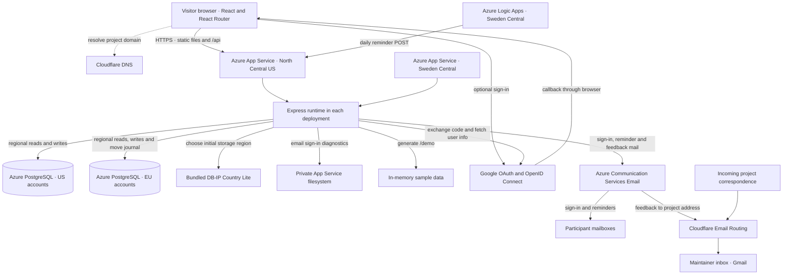
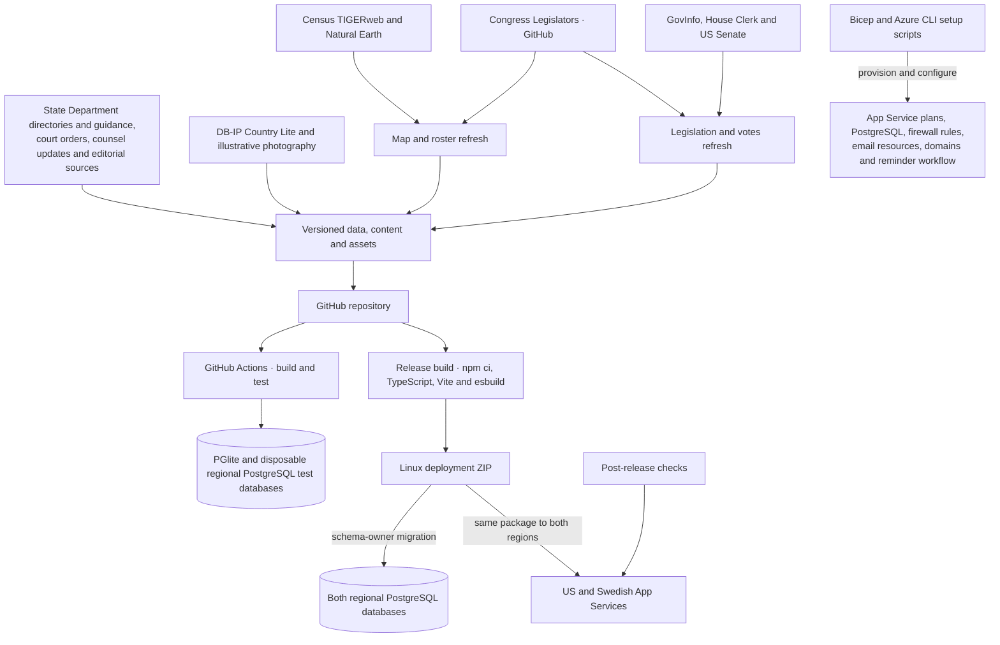
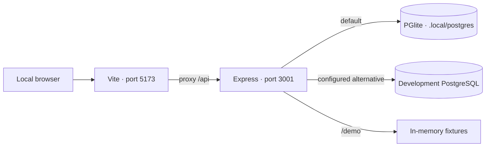

# Architecture

Reunite Now serves a React application and an Express API from the same origin. The petition uses two PostgreSQL databases. Reference maps, legislation and editorial content ship with the application. Visitors can read these without an account.

## Production services

The browser loads React, Leaflet maps and bundled reference files from the same origin as the Express API. The canonical domain points to the US app. Both regional App Services run the same Node.js package and can reach both regional databases.

Public database reads use consent-filtered views. Account operations use the runtime writer. Story photo processing runs inside Express using Sharp. The local DB-IP lookup keeps visitor IP addresses within the app. The mailbox migration described below is a planned alternative to forwarding.

## Reference data, delivery and local development

The refresh scripts and editorial process produce versioned files. The deployed app serves those files alongside the frontend. GitHub Actions validates the repository, and the release operator packages and deploys a verified build.

The [source inventory](PUBLIC-DATA.md) identifies each reference dataset and its refresh process. The [CI workflow](../.github/workflows/ci.yml), [infrastructure templates](../infra/) and [packaging script](../scripts/package.py) define the build and release paths.

## Follow a request

1. Vite builds the browser entry point in `client/src/main.tsx`. React Router selects the page. The account and map routes load their code on demand. The Express server serves the built files and supports direct links to nested routes.
2. The gallery requests matching cards by cursor. Story text and full photos load when a story opens. The homepage and signature map share grouped counts, and the visa dashboard filters a shared snapshot in the browser. Public snapshots are reused in browser memory for one minute between visits; private account responses are not cached there.
3. Express validates input, resolves the signed-in session for private operations and runs parameterized queries using the regional pool. Public queries select consented records in both regions. Regional results are combined before responding. A failed regional read fails the request so an incomplete count cannot look like the full count.
4. The read-only preview under `/demo` serves synthetic data generated in memory. It bypasses live account reads and editing. Local developers can separately enable sample data with `npm run dev:demo`.

| Where to work | Responsibility |
| --- | --- |
| `client/src/app/` and `main.tsx` | API access, data context, preview detection, navigation and routes |
| `client/src/features/` | Account and sign-in flows, maps, policy tracking and story browsing |
| `client/src/pages/` | Landing page, About, Data Use, Sources and Feedback |
| `client/src/components/`, `i18n/`, `styles/` | Reusable controls, eight-language interface, locale catalogs and CSS |
| `shared/` | Validated record formats, statistics, public response types and source-backed content |
| `server/index.ts`, `server/http/`, `server/stories/` | HTTP entry point, middleware, public story routes and photo processing |
| `server/storage/`, `server/data/` | Database access, schema, regional routing and IP-country lookup data |
| `server/email/`, `server/jobs/`, `server/cli/`, `server/demo/` | Email delivery and sign-in diagnostics, reminder jobs, CLI commands and sample data |
| `infra/` and `scripts/` | Infrastructure templates, setup helpers, data refreshes, packaging and live checks |

## Regional storage and recovery

The canonical hostname serves requests through the US App Service. Both web deployments connect to Sweden Central and North Central US using `DATABASE_URL_EU` and `DATABASE_URL_US`. Each database holds a different set of accounts. Loss of either can interrupt requests. Production requires two distinct databases and uses verified database TLS. Local development can use PGlite or one PostgreSQL connection.

For a new account, the server looks up the App Service ingress IP locally using DB-IP Country Lite. EU addresses select Sweden. Other or unknown addresses select the US. Existing accounts follow their saved home when signing in again. Review the trusted ingress header in `server/index.ts` before introducing a proxy.

An account move takes an exclusive PostgreSQL advisory lock. A journal in Sweden stores the account ID and destination. The destination commits the account, profile, story, auth and reminder records before the source is cleared. Ordinary routed requests take a shared lock and check the journal. They finish interrupted moves under an exclusive lock before resuming. If a move fails, restore connectivity and retry the same destination. Keep both regional databases together in recovery planning. The [user data guide](DATA.md) covers safe restores.

## Authentication, domains and email

- The canonical origin is `https://visatransparencypetition.org`. Custom hostnames need DNS, an Azure hostname binding and TLS. For a cutover, check the apex and www, redirects preserving deep links, `APP_URL`, and the Google OAuth callback at `/api/auth/google/callback`. The checked-in zone file describes an earlier cutover. Compare it with current DNS before importing any records.
- Email sign-in consumes a single-use token on a confirmation POST. Google sign-in verifies the identity through OAuth. Production sessions use a secure HTTP-only cookie. Store OAuth credentials, database credentials and the job secret in restricted service configuration. Browser bundles and Git are public.
- Azure Communication Services sends sign-in mail, feedback and reminders from the verified project sender. It supports a connection string or a configured endpoint with an authorized managed identity. Cloudflare Email Routing forwards incoming project correspondence. Incoming routing and the Azure sender have separate DNS requirements. Preserve Azure DKIM records and use a single SPF policy for authorized senders.
- The daily Logic App in Sweden calls `/api/jobs/reminders` using `CRON_SECRET`. Keep a single active schedule. After changing the canonical URL or secret, review and run `scripts/configure-reminders.py`. If delivery is uncertain, check the provider before retrying. The job reuses deterministic operation IDs and leaves pending claims older than 23 hours for manual reconciliation.

## Build, release and check

From the repository root, run `npm ci`, `npm run build` and `npm test`. Use `npm run dev` for the local frontend and API. Run `npm run test:integration` against a disposable local API. GitHub Actions also exercises moves between two PostgreSQL databases. See the [CI workflow](../.github/workflows/ci.yml) for the services and environment.

Package the verified build once with `python3 scripts/package.py`. Deploy that same `work/reunite-now.zip` to both App Services. The US target is `reunite-now-9a04` in `reunite-now-rg`. The Swedish target is `reunite-now-eu-9a04` in `reunite-now-eu-rg`. In restricted mode the release job runs migrations and the historical photo cleanup before the web apps restart. Legacy deployments and embedded local development still bootstrap at startup. Allow time for startup before checking the public build.

Run `python3 scripts/verify-live.py` for read-only health, configuration, coverage and Google redirect checks. Verify the public HTML serves the expected asset and open a changed route. Inspect Azure deployment status in both regions. Testing actual mail delivery requires a designated inbox. The optional `--check-reminders` flag runs the real delivery job for eligible users.

## Database roles and release order

The API supports separate database logins for public reads and private operations. The public reader can read four owner-defined, security-barrier views. The signatory list reads opted-in names and original signing times. Coverage returns grouped signatures, visa statistics use projected milestone data, and story reads require a signed, consented profile and a published story. The reader has no access to base tables. The runtime login handles authentication, account data, reminders and journal recovery with explicit table and column grants. It does not own tables, run migrations or need schema creation or truncate privileges.

1. In each database server provision two non-login group roles named `rn_reader` and `rn_runtime`. Create a distinct non-owner login for each group in each region. Grant each login only its matching group. Use ordinary roles without superuser, database creation, role management or row-security bypass privileges. Check inherited privileges, including CREATE on the public schema on older PostgreSQL installations.
2. From a trusted release environment, supply `DATABASE_URL_EU` and `DATABASE_URL_US` for the schema owner. Run `node dist/migrate.js --grant-app-roles` from the packaged build. Omit reader URLs in that process. This command creates or updates the schema, grants access to named objects and backfills historical photos. Migrations are repeatable and serialized per regional database. Keep release credentials out of the web app settings.
3. Supply each web app with its two runtime URLs in `DATABASE_URL_EU` and `DATABASE_URL_US` and its reader logins in `DATABASE_READER_URL_EU` and `DATABASE_READER_URL_US`. Each reader must target the same host and database as its corresponding writer. Set all four together. The app checks the reader's private-table access, the writer's schema privileges and the public views before listening. In this mode each region's six query connections are divided between writer and reader pools. Sweden has a separate coordinator pool.
4. Roll out one App Service at a time. Verify readiness, public statistics, a published story, account edits and an authorized test account's regional transfer before moving the second instance. Keep the prior settings in restricted recovery storage. To roll back the app, restore a compatible package and matching settings. The views and group grants are additive.
5. For a fresh infrastructure provisioning run in restricted mode, `scripts/provision.py` also takes `DATABASE_ADMIN_URL_EU` and `DATABASE_ADMIN_URL_US` for provisioning only. An operator must prepare the databases and logins before directing traffic to the restricted app. See [regional CI](../.github/workflows/ci.yml) for a two-database example using disposable logins.

The coordinator still uses runtime credentials and may recover an interrupted move during a public request. The same web process also runs reminder and private account operations. Its writer can access private rows and delete a user with cascading effects. Separate worker identities and database-enforced per-account authorization are further steps. The restricted reader isolates the public *queries*. It cannot contain a compromise of the entire web process.

## Moving the correspondence mailbox to Google Workspace

The project address is `ethan@visatransparencypetition.org`. Cloudflare handles incoming forwarding until the MX cutover. To use Gmail in a browser, create a Google Workspace user with that address, verify domain ownership with Google's unique TXT record, and then activate Gmail. Keep Cloudflare as the DNS host. At cutover, replace the Cloudflare routing MX records with Google's prescribed MX record. Preserve Azure sender verification and DKIM. Authorize both Google and Azure in the single root SPF policy, and publish the separate Google DKIM selector.

Send from an independent inbox, reply from the project mailbox in Gmail, and check the public From address and reply destination. Verify an Azure sign-in message and a feedback reply independently. Old forwarded messages remain in the previous inbox unless migrated. Once delivery is verified, update the description of incoming correspondence on the Data Use page and in the user data guide. [Google Workspace MX setup](https://knowledge.workspace.google.com/admin/domains/set-up-mx-records-for-google-workspace)
